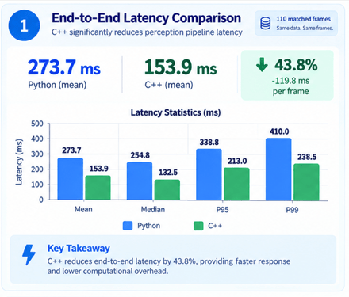

# 13 — C++ Perception Core (Python → C++ Migration of the Unified Perception Stack)

## Objective

Migrate the computational core of the Phase 12 unified perception stack from Python to **C++**, and expose it to the existing ROS2 node through a **single pybind11 call per frame**, while keeping the parts that depend on Python-only ecosystems (ROS2, YOLO/TensorRT, ByteTrack) exactly where they are.

Phase 12 proved the fusion logic. This milestone makes it fast and structurally clean: LiDAR projection, mask-cloud extraction, distance/position estimation, track-ID attachment, radar fusion, object counting, nearest-object and BEV preparation, and GNSS/IMU ego motion now run in one C++ orchestrator, and the Python callback receives a single result dictionary.

**Question addressed:**

> **How can the computational half of a multi-sensor perception stack be moved to C++ without changing its behavior, and without paying for a Python ↔ C++ boundary crossing at every step?**

---

## Motivation

In the incremental version of the port, each C++ function was bound separately and called from the Python callback. Every call converted NumPy → C++ on the way in and C++ → Python on the way out. For one synchronized frame the callback made **23 separate calls** into the C++ module:

```text
project_lidar                ×4  (one per camera)
extract_object_clouds        ×4
process_object_clouds_and_distance ×4
attach_track_ids             ×4
RadarPerceptionPipeline.process    ×1
attach_radar_data            ×1
count_objects                ×1
prepare_nearest_objects      ×1
prepare_bev_objects          ×1
GNSSPipeline.process         ×1
IMUPipeline.process          ×1
```

The computation was already in C++, but the boundary overhead and the intermediate Python objects (point clouds, world-object lists, per-step conversions) were not.

The fix is architectural rather than algorithmic: one C++ facade, `PerceptionOrchestrator`, owns the whole computational pipeline and is called **once per frame**.

---

## Architecture

```text
        Front / Rear / Left / Right Cameras
              +  Radar  +  LiDAR
              +  IMU    +  GNSS
                    │
                    ▼
        TimeSynchronizer (8-way sync)              ── Python / ROS2
                    │
                    ▼
        YOLO26m-seg TensorRT Detection             ── Python
        (per camera, ego-hood masked)
                    │
                    ▼
        ByteTrack (per camera)                     ── Python
                    │
                    ▼
    ┌─────────────────────────────────────────┐
    │  perception_cpp.PerceptionOrchestrator  │    ── ONE pybind11 call
    │              .process(...)              │
    └─────────────────────────────────────────┘
                    │
                    ▼
        ┌──────────────────────────────── C++ ────────────────────────────────┐
        │                                                                     │
        │  per camera (front / rear / left / right):                          │
        │     project_lidar()                                                 │
        │        → extract_object_clouds()                                    │
        │        → process_object_clouds_and_distance()                       │
        │        → attach_track_ids()            (F / R / L / RT)             │
        │                                                                     │
        │  front camera only:                                                 │
        │     RadarPerceptionPipeline.process()                               │
        │        → attach_radar_data()                                        │
        │                                                                     │
        │  merge cameras → drop objects without track ID                      │
        │        → count_objects()                                            │
        │        → prepare_nearest_objects()                                  │
        │        → prepare_bev_objects()                                      │
        │                                                                     │
        │  GNSSPipeline.process()  →  IMUPipeline.process()  →  heading_deg   │
        └─────────────────────────────────────────────────────────────────────┘
                    │
                    ▼
        Result dict (images · counts · nearest · BEV · GNSS · IMU)
                    │
                    ▼
        Dashboard Payload Assembly + Metrics       ── Python
                    │
           ┌────────┴────────┐
           ▼                 ▼
   DashboardBridge     Dataset Recorder
    (WebSocket)        (CSV, frames 1–110)
```

The Python node keeps the sensor I/O, the neural network, the tracker, and the presentation layer. Everything that turns detections and sensor data into a world model is in C++.

---

## Project Structure

```text
13_perception_cpp/
├── assets/
│   ├── gifs/
│   └── images/
├── csv_data/
│   └── perception_log_cpp.csv
├── include/
│   ├── perception_3d_pipeline.hpp
│   ├── perception_utils.hpp
│   ├── radar_perception_pipeline.hpp
│   ├── gnss_pipeline.hpp
│   ├── imu_pipeline.hpp
│   └── perception_orchestrator.hpp
├── src/
│   ├── perception_3d_pipeline.cpp
│   ├── perception_utils.cpp
│   ├── radar_perception_pipeline.cpp
│   ├── gnss_pipeline.cpp
│   ├── imu_pipeline.cpp
│   └── perception_orchestrator.cpp
├── bindings/
│   ├── bindings.cpp                 # exposes PerceptionOrchestrator (module: perception_cpp)
│   └── bindings_copy.cpp            # per-class bindings used during incremental porting
├── perception/
│   ├── perception_node.py           # ROS2 node, now calls the C++ orchestrator
│   ├── yolo_detection_pipeline.py
│   ├── dashboard_adapter.py
│   ├── dashboard_bridge.py
│   ├── dashboard_metrics.py
│   └── recorder_perception.py
├── CMakeLists.txt
└── README.md
```

The Python reference implementations from Phase 12 (`perception_3d_pipeline.py`, `perception_utils.py`, `radar_perception_pipeline.py`, `gnss_pipeline.py`, `imu_pipeline.py`) remain the behavioral specification the C++ code was written and checked against.

---

## Key Components

### PerceptionOrchestrator

`PerceptionOrchestrator` (`perception_orchestrator.hpp / .cpp`) is the single entry point. It owns one instance of each pipeline (`Perception3DPipeline`, `PerceptionUtils`, `RadarPerceptionPipeline`, `GNSSPipeline`, `IMUPipeline`) and keeps their state across frames, which matters for the stateful parts: per-track motion history and GNSS speed differencing.

`process()` takes, in one call:

| Input | Shape / type |
|---|---|
| LiDAR | `(N, 3)` float32, ego frame |
| Camera images | four BGR `uint8` `(H, W, 3)` arrays |
| Segmentation masks | `(N, H, W)` float per camera, or `None` |
| Boxes / classes | `(N, 4)` `xyxy` and `(N,)` class IDs per camera |
| Front scores | `(N,)` — used by radar association |
| Radar points | `(M, 4)` `[depth, azimuth, altitude, velocity]`, front camera only |
| Tracker targets | ByteTrack output per camera (`track_id`, `tlwh`) |
| Class names | `model.names` dictionary |
| Image sizes | width/height per camera |
| Timestamp | seconds, from the GNSS message header |
| GNSS | latitude, longitude, altitude |
| IMU | the ROS `Imu` message (linear acceleration, yaw rate, orientation) |

and returns one dictionary:

```text
front / rear / left / right   annotated BGR images (LiDAR points drawn on objects)
object_counts                 {vehicle, person, cyclist}
nearest_objects               [{id, cls, label, dist_m, speed_mps, motion}, ...]
bev_objects                   [{id, cls, x, y, distance}, ...]
gnss                          {position (ENU), speed}
imu                           {acceleration, yaw_rate, heading, motion_state}
heading_deg                   heading in degrees
```

The output schema deliberately matches the dashboard payload fields from Phase 12, so the Python side only wraps and forwards it.

---

### Camera–LiDAR 3D Localization (C++)

`Perception3DPipeline` reproduces the Phase 12 geometry in three stages:

1. **`project_lidar()`** — rotates the LiDAR cloud by the camera's mounted yaw (front 0°, rear 180°, left −90°, right 90°), applies the LiDAR → camera translation and the CARLA → camera axis remap, pinhole-projects with `fx, fy, cx, cy`, and discards points behind the camera or outside the image. The original ego-frame coordinates are kept alongside each surviving `(u, v)`.
2. **`extract_object_clouds()`** — converts each YOLO mask to `uint8`, resizes it to the image size with nearest-neighbor interpolation, and collects the projected points that fall inside it, producing one `ObjectCloud` per detection.
3. **`process_object_clouds_and_distance()`** — draws each object's LiDAR points on the image, then computes distance as the 10th percentile of point ranges and position as the mean of the front-surface points (points at or below that percentile). Objects with no LiDAR points are skipped.

---

### Track-ID Attachment and Radar Fusion (C++)

`PerceptionUtils::attach_track_ids()` matches each localized object to ByteTrack output by IoU (threshold `0.3`) and assigns a camera-prefixed ID:

```text
front → F_<id>      rear → R_<id>      left → L_<id>      right → RT_<id>
```

ByteTrack itself stays in Python. The bindings convert each tracker target (`track_id`, `tlwh`) into a C++ `TrackTarget` at the boundary.

For the front camera, `RadarPerceptionPipeline::process()` projects radar returns into the image, associates each with the detection whose box contains it and whose center it lands closest to, and computes range, bearing, radial velocity, and a motion state. `PerceptionUtils::attach_radar_data()` then merges those onto the world objects by IoU (threshold `0.3`). `WorldObject` carries the radar fields directly (`has_radar`, `radar_range`, `radar_bearing`, `radar_velocity`, `radar_motion`).

```text
Approaching   → velocity < -threshold
Receding      → velocity > +threshold
Stationary    → otherwise
```

---

### World Objects, Nearest Objects, BEV, Counting (C++)

After the four cameras are merged, objects **without a track ID are removed**, and the remaining list feeds:

- **`count_objects()`** — `vehicle`, `person`, `cyclist` totals (trucks and buses count as vehicles)
- **`prepare_nearest_objects()`** — per object `{id, cls, label, dist_m, speed_mps, motion}`, sorted by distance
- **`prepare_bev_objects()`** — per object `{id, cls, x, y, distance}` for the bird's-eye-view panel

Class normalization is unchanged from Phase 12: `car → vehicle`, `truck/bus → truck`, `person → person`, `bicycle/motorcycle → cyclist`.

Motion resolution priority is unchanged as well:

```text
Radar available    → radar velocity / motion
Radar unavailable  → LiDAR temporal position-delta speed / motion (0.2 m/s threshold)
Otherwise          → speed = 0, motion = "unknown"
```

The temporal fallback keeps a per-track position history inside `PerceptionUtils`, so it persists across frames in the orchestrator.

---

### Ego Vehicle Motion (C++)

- **`GNSSPipeline`** converts each `(lat, lon, alt)` fix to a local ENU position relative to the first fix, using an explicit WGS84 geodetic → ECEF → ENU conversion (this replaces `pymap3d` from Phase 12), then differentiates consecutive positions to get speed.
- **`IMUPipeline`** computes acceleration, yaw rate, and heading (`2·atan2(z, w)` from the orientation quaternion), and classifies the discrete motion state — `Stationary` / `Moving Forward`, `Accelerating` / `Braking`, `Turning Left` / `Turning Right` — with the same thresholds as Phase 12.

The GNSS-derived speed feeds the IMU motion-state logic inside the orchestrator, exactly as the Python node did across two calls.

---

### pybind11 Bindings

The extension module is named **`perception_cpp`**.

- `bindings.cpp` exposes `PerceptionOrchestrator` and its single `process()` method. It converts NumPy arrays, ByteTrack targets, the class-name dictionary, and the ROS `Imu` message on the way in, and converts the C++ result (including `cv::Mat` → NumPy) into a Python dictionary on the way out.
- `bindings_copy.cpp` exposes the individual classes (`Perception3DPipeline`, `PerceptionUtils`, `RadarPerceptionPipeline`, `GNSSPipeline`, `IMUPipeline`) and their result structs. It was the binding used while each stage was ported and checked in isolation.

---

### Python Node Changes

`perception_node.py` (`PerceptionStack`) keeps its Phase 12 structure. What changed is the middle of the callback:

```text
Phase 12                                   Phase 13
────────                                   ────────
YOLO ×4                                    YOLO ×4                 (unchanged)
ByteTrack ×4                               ByteTrack ×4            (unchanged)
LiDAR conversion                           LiDAR conversion        (unchanged)
Python project / extract / process ×4      ┐
Python track-ID attachment ×4              │
Python radar process + attach              ├─ perception_orchestrator.process(...)
Python counts / nearest / BEV              │
Python GNSS / IMU                          ┘
Dashboard payload assembly                 Dashboard payload assembly (fed from result dict)
```

The dashboard adapter still builds the per-camera tracked boxes and JPEG frames from the images returned by C++.

---

### Dataset Recording

The node records the assembled payload to CSV in one batch, following the same column layout as the reference log:

- Recording **starts when frame 1 arrives**; frames before it are ignored
- Frames are buffered in memory; duplicate frame IDs are skipped
- The CSV is written **once**, only after all unique frames **1–110** are present, in frame-ID order
- After a successful write, recording is marked finished

The output is `csv_data/perception_log_cpp.csv`, the C++-pipeline counterpart of the Phase 12 log, so the two runs can be compared column-for-column.

---

## Migration Approach

The port followed a strict cycle for each component:

```text
PLAN → IMPLEMENT → BUILD / TEST → VERIFY against Python → NEXT STEP
```

Order of migration:

```text
1. LiDAR projection, object clouds, distance/position   (Perception3DPipeline)
2. Track-ID attachment                                   (PerceptionUtils)
3. Radar association and radar attachment                (RadarPerceptionPipeline)
4. Counting, nearest objects, BEV                        (PerceptionUtils)
5. GNSS and IMU                                          (GNSSPipeline, IMUPipeline)
6. Single-call facade                                    (PerceptionOrchestrator)
```

Each stage was bound individually and compared against the Python implementation on the same input before the next was started. The LiDAR projection check compared the Python and C++ `(u, v)` arrays and projected points to a `1e-5` tolerance. Only after every stage matched was the per-call wiring replaced by the orchestrator.

The Python reference implementations were kept in place throughout, so the C++ and Python paths can be switched and compared on the same replay data.

---

## Build

The extension is built with CMake against pybind11, Eigen, and OpenCV, and produces a `perception_cpp` shared library.

```bash
cmake -S . -B build -DCMAKE_BUILD_TYPE=Release
cmake --build build -j
```

Make the built module importable from the ROS2 node's Python environment (for example by adding the build directory to `PYTHONPATH`), then:

```python
import perception_cpp

orchestrator = perception_cpp.PerceptionOrchestrator()
result = orchestrator.process(lidar, front, front_masks, front_boxes, front_scores,
                              front_classes, radar_points, front_targets,
                              rear, ..., left, ..., right, ...,
                              model.names,
                              front.shape[1], front.shape[0], ...,
                              timestamp,
                              gnss_msg.latitude, gnss_msg.longitude, gnss_msg.altitude,
                              imu_msg)
```

Run the node against the replay from Phase 12 (`multi_sensors_replay.py`) to get deterministic, frame-accurate input.

---

## Validation and Benchmarking

**Validation.** Correctness is defined by the Phase 12 Python pipeline. The C++ output is compared with the Python output on identical replayed frames, using the recorded CSV (`perception_log_cpp.csv` vs. the Phase 12 log) for the object-level fields: track IDs, classes, distances, BEV positions, nearest-object motion, object counts, and ego state.

**Latency.** The node measures end-to-end callback latency (`latency_ms`) from the start of the synchronized callback to just before the dashboard payload is finalized, and records it per frame alongside FPS and CPU/GPU utilization.

| Metric | Phase 12 (Python) | Phase 13 (C++) |
|---|---|---|
| Boundary crossings per frame | 23 | 1 |
| Mean latency (ms) | TBD | TBD |
| p95 latency (ms) | TBD | TBD |
| FPS | TBD | TBD |

---

## Software Architecture

```text
Replay Node (or live CARLA bridge)
     │
     ▼
Sensor Synchronization (TimeSynchronizer, 8-way)
     │
     ▼
Python:  DetectionPipeline (YOLO TensorRT)  →  BYTETracker ×4
     │
     ▼
pybind11 boundary  (bindings.cpp — 1 call / frame)
     │
     ▼
C++:  PerceptionOrchestrator
        ├── Perception3DPipeline     (project · extract · distance)
        ├── PerceptionUtils          (track IDs · radar attach · counts · nearest · BEV)
        ├── RadarPerceptionPipeline  (front camera)
        ├── GNSSPipeline
        └── IMUPipeline
     │
     ▼
pybind11 boundary  (result dict)
     │
     ▼
Python:  DashboardAdapter · DashboardMetrics · payload assembly
     │
     ├─────────────────────────┐
     ▼                         ▼
DashboardBridge          Dataset recorder
(WebSocket push)         (CSV, frames 1–110)
```

| Module | Language | Responsibility |
|---|---|---|
| **Replay Node** | Python | Publish recorded, synchronized sensor data as ROS2 messages |
| **DetectionPipeline** | Python | ROS→OpenCV conversion, hood masking, YOLO TensorRT inference |
| **BYTETracker** | Python | Persistent per-camera track identity |
| **PerceptionOrchestrator** | C++ | Single per-frame entry point; owns all C++ pipelines and their state |
| **Perception3DPipeline** | C++ | LiDAR → camera projection, mask-cloud extraction, distance/position |
| **PerceptionUtils** | C++ | Track-ID and radar attachment, class normalization, counts, nearest, BEV, temporal motion |
| **RadarPerceptionPipeline** | C++ | Radar geometry, projection, association, range/bearing/velocity/motion |
| **GNSSPipeline / IMUPipeline** | C++ | Ego ENU position, speed, heading, discrete motion state |
| **bindings.cpp** | C++ | NumPy/ROS ↔ C++ conversion, `perception_cpp` module |
| **DashboardAdapter / DashboardMetrics** | Python | Camera payload (boxes, JPEG), FPS/CPU/GPU metrics |
| **PerceptionStack Node** | Python | Synchronized input, orchestration, payload assembly, recording |
| **DashboardBridge** | Python | Thread-safe WebSocket broadcast |

The guiding split is unchanged from Phase 12: computation lives in pipeline classes, and the ROS2 node coordinates inputs and outputs. The difference is that the computation is now one C++ unit instead of a set of Python classes called in sequence.

---

## Engineering Outcome

Successfully moved the computational core of the unified perception stack to C++ and collapsed it behind a single pybind11 call per frame. The ROS2 node, YOLO/TensorRT inference, ByteTrack, and the dashboard are unchanged in role; the Python callback now hands detections, tracker output, and raw sensor data to `PerceptionOrchestrator` and receives the finished world model in return.

For every frame the C++ core produces:

- Per-camera annotated images with LiDAR points drawn on detected objects
- Track-ID-labelled world objects with 3D position and distance (camera–LiDAR)
- Range, bearing, and radial velocity for front-camera objects with a radar match
- Nearest-object list with radar-derived or LiDAR-temporal motion
- BEV object list and per-class object counts
- Ego position (local ENU), speed, heading, and discrete motion state

This reduces 23 Python ↔ C++ calls per frame to one, removes the intermediate Python object construction between stages, and leaves a single, testable C++ unit that can be extended with the remaining fusion steps.

---

## Deliverable

<h3 align="center">C++ Perception Core</h3>

<p align="center">
  
</p>

<p align="center">
The Phase 12 perception output — tracked camera feeds, BEV, nearest objects, and ego motion — now produced by a single C++ orchestrator call per frame.
</p>

---

## Technologies

- C++ (Eigen, OpenCV)
- pybind11
- CMake
- CARLA 0.9.15
- ROS2 Humble
- YOLO26m-seg (TensorRT FP16 engine)
- ByteTrack
- Python
- NumPy
- WebSockets
- psutil / pynvml
- CV Bridge
- CycloneDDS

---

## External Dependencies

- **Eigen** — vector/matrix math for projection, transforms, and ego motion
- **OpenCV (C++)** — mask resizing and LiDAR-point drawing
- **pybind11** — Python bindings, NumPy and Eigen conversion
- **Ultralytics YOLO / TensorRT** — segmentation-detection inference (Python)
- **ByteTrack (YOLOX tracker)** — multi-object tracking (Python)
- **message_filters.TimeSynchronizer** — 8-way synchronized sensor input (Python)
- **websockets / psutil / pynvml** — dashboard transport and system metrics (Python)

`pymap3d` from Phase 12 is no longer required on the perception path; the GNSS geodetic-to-ENU conversion is implemented directly in C++.

---

## Scope

Phase 13 focuses on **porting the computational perception core to C++ behind a single-call interface, preserving Phase 12 behavior**.

The following remain outside the scope of this milestone:

- YOLO / TensorRT inference (stays in Python)
- ByteTrack (stays in Python)
- ROS2 message handling and synchronization (stays in Python)
- Global cross-camera object identity (track IDs remain camera-local)
- Radar fusion on rear/left/right cameras (front camera only)
- Trajectory prediction, time-to-collision, planning, and control

---

## Known Limitations

- **Camera-local IDs.** Track IDs are unique per camera, as in Phase 12.
- **Front-only radar.** The orchestrator accepts radar points for the front camera only.
- **Fixed radar configuration.** Radar thresholds, camera intrinsics, and the radar-to-camera extrinsic live inside the C++ radar pipeline; they must match the values used by the Python node when comparing outputs.
- **Mask transfer cost.** Segmentation masks are converted from NumPy into nested C++ vectors before the object-cloud stage. This is a known candidate for optimization (passing the buffer directly to OpenCV).
- **Class-name table size.** The bindings map `model.names` into a fixed-size table (80 entries).

---

## Outcome

Phase 13 successfully ported the Phase 12 perception core to C++ and unified it behind `PerceptionOrchestrator`, reducing the per-frame Python ↔ C++ interface from 23 calls to one while leaving ROS2, YOLO/TensorRT, ByteTrack, and the dashboard untouched. The C++ core performs LiDAR projection, mask-cloud extraction, distance and position estimation, track-ID attachment, front-camera radar fusion, object counting, nearest-object and BEV preparation, and GNSS/IMU ego-motion estimation, and returns a single result dictionary that feeds the existing dashboard payload and CSV recorder. With the computational path now in C++, the next priorities are output-parity validation, latency benchmarking, and extending the orchestrator with the remaining fusion stages.